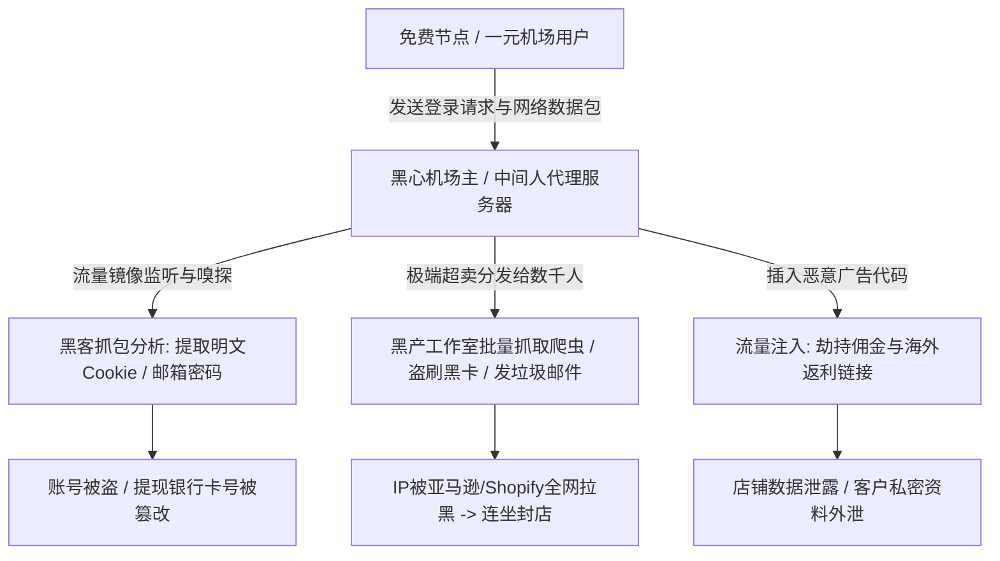

# 4-11. 为什么坚决不能用免费节点或“一元机场”运营跨境电商店铺？

在跨境电商开店、外贸获客或海外社媒营销的圈子里，经常能看到一些让人哭笑不得的操作：有的小白卖家斥资数万元进货、搭建精美的独立站、甚至花高价找海外红人拍摄了带货素材，然而在最基础的“网络工具”上，却舍不得花钱，每天在网上各大 Telegram 频道、技术论坛四处搜刮所谓的“每日免费订阅节点”，或者花 1 块钱买一个号称“永久 100G”的超低价一元机场，用来登录自己的亚马逊、Shopify、Shopee 或 TikTok 卖家后台。

结果往往在短短几天甚至几个小时内以悲剧收场：**店铺后台刚登录就被强制登出并提示“可疑欺诈”**、**亚马逊店铺因“关联未知违规账号”被永久封杀**、**连带绑定的海外信用卡或 PayPal 收款账户直接被拉入金融黑名单**。

为什么这种看似只是每个月省下十几块钱的“省钱操作”，在外贸电商圈内被所有资深老鸟公认为“最典型的自杀式行为”？免费节点和一元机场的底层网络到底藏着怎样耸人听闻的黑产陷阱与致命毒药？想要为你的出海核心商业资产构建坚不可摧的安全护城河，强烈建议深入阅读我们的年度权威避坑大文：《[TikTok 与跨境电商防关联独享原生 IP 方案推荐](/pillar-4)》。本文将为你深入扒开免费与一元节点背后的肮脏底牌，彻底讲透它摧毁跨境店铺的四大致命刀口。

---

## 一、底牌揭秘：免费节点和一元机场究竟靠什么生存？

互联网世界有一条永恒不变的铁律：**“天下绝没有免费的午餐。如果你没有为产品买单，那么你本身就是被打包出售的产品。”** 

一台部署在海外的高性能服务器，其每月的机房电费、硬件损耗、IP 租金以及昂贵的国际骨干网络出口带宽，都是极其刚性的硬成本。那么，市面上那些号称“完全免费”或者“1元包月”的服务，背后到底靠什么牟利？

### 1. 致命商业模型：中间人抓包（MITM）与隐私数据转卖
*   免费节点和一元机场背后，绝大多数充斥着专门从事灰黑产的专业团伙；
*   你通过其节点发送的每一个未加密数据包、你的登录 Session 凭证、甚至你在后台敲入的密码和客户敏感信息，**都在其控制的中继服务器上被实时镜像抓包与自动化扫描**！
*   一旦识别到高价值的电商卖家 Cookie，黑客可在无需二次验证码的情况下直接接管你的店铺后台，悄悄篡改你的提现银行卡号（Payout Account），将你整整一个月的利润洗劫一空！

### 2. 极端疯狂的“万人挤独木桥”超卖与黑产污染
*   一台月租仅几美元的廉价劣质 VPS，机场主会将其分发给上万名免费白嫖党；
*   在这上万人中，大量黑产工作室在利用该 IP 批量扫号、进行信用卡测活（Carding）、发送海量诈骗垃圾邮件。
*   **该 IP 在全球所有反欺诈与网络安全雷达（MaxMind, Spamhaus, Cloudflare）中，早已被标记为最高危的“纯黑名单恶意僵尸源”！**

---

## 二、为什么用它登录店铺“必死无疑”？四大绞杀维度

如果你敢挂着免费或一元节点登录跨境电商店铺，你将瞬间面临以下四重毁灭性打击：

### 维度一：100% 触发平台的“关联连坐封店（Account Linkage Suspension）”
*   亚马逊、Shopee、Etsy 等平台的关联算法，只要发现多个不同的店铺在近期使用**同一个高危公网 IP** 登录过后台，就会自动在数据库中将其标记为由“同一违规操盘团伙控制”；
*   在你的免费节点前面，可能刚刚有 20 个违规刷单、卖假货、盗刷退款的黑号因为被封弃号。你挂着这个 IP 登录自己辛辛苦苦打造的正规店铺，**无异于自己把脚伸进绞刑架，当场被无差别连坐处决！**

### 维度二：断崖式漂移导致“防盗号紧急冻结”
*   一元机场的服务器极不稳定，节点几分钟就断流一次，或者自动跳跃到另一个国家的廉价机器上；
*   上午你在美国美西登录，10 分钟后掉线重连到了欧洲保加利亚，下午又漂移到了南非。这种在数小时内跨时区的超光速瞬移，会被 Shopify 或亚马逊的安全探针直接识别为“遭受境外黑客暴力撞库盗号”，系统立刻自动封锁后台，要求出具营业执照、法人身份证、采购发票甚至公证水电账单进行极为痛苦的人工申诉。

### 维度三：严重缺乏双 ISP 住宅资质（Hosting 属性暴露无遗）
*   免费和一元机场使用的 100% 是成本最低的数据中心机房 IP（Hosting）；
*   跨境电商平台自身就是云计算巨头（如亚马逊 AWS），对全球机房段了如指掌。你挂着一查即知的机房 IP 假装在“海外本地实体办公”，在平台风控系统面前等同于小丑在聚光灯下表演！

### 维度四：高频丢包导致关键数据传输断流受损
在进行商品批量表格上传、大促前夜价格调整、或者处理买家争议纠纷时，一元机场高达 30% 以上的晚高峰丢包率会导致提交的数据包损坏丢失，甚至引发前后台数据错乱崩溃。

---

## 三、真实惨案：贪小便宜吃大亏的血泪账本

| 运营者决策 | 表面省下的钱 | 最终付出的惨痛代价 | 综合教训反思 |
| :--- | :--- | :--- | :--- |
| **卖家 A：用 1 元机场维护 Etsy 手工店** | 每年省下约 ¥300 元专业网络费 | 开店仅 2 天，因检测到机房代理与历史违规关联，**店铺永久封禁，法人身份作废** | Etsy 对住宅 IP 零容忍，彻底断送入场资格 |
| **卖家 B：用免费节点登录亚马逊欧洲站** | 以为“能打开网页就行” | 遭遇中间人劫持，欧洲站后台提现银行信息被篡改，**近 €15,000 欧元货款被黑客卷走** | 免费往往是世界上最昂贵的东西 |
| **团队 C：用一元梯子运营 TikTok 矩阵** | 团队为了省成本购买廉价合租套餐 | 连续发布 300 条原创带货短视频，**100% 遭遇 0 播放沙盒限流** | 几十万元的人力和拍摄成本全部打水漂 |

---

## 四、外贸人的正确网络投资观

做跨境出海，必须建立清醒的“生产资料投入认知”：
1. **网络是你的数字大门：** 就像实体做生意开店要租正规商铺一样，一条合规安全的网络专线，是维系你全部数字资产运转的“地基”；
2. **专业分工，专线专用：**
   *   **看视频/查资料（日常娱乐）：** 可以用性价比高的大带宽专线；
   *   **管店铺/做收款/投广告（核心生产力）：** **必须且只能使用个人独享的“纯净静态住宅双 ISP 专线”**，配合指纹浏览器进行 100% 物理隔离。

---

## 五、结语
不要在最核心的生命线上盲目省钱！每一个跨境电商店铺背后，都凝结着无数日夜的心血与巨额的供应链投资。彻底砸碎免费节点与一元机场的虚假幻象，为你的商业帝国装配真正纯净安全的专用网络基座，才能在这场全球淘金的征途中行稳致远、满载而归！
