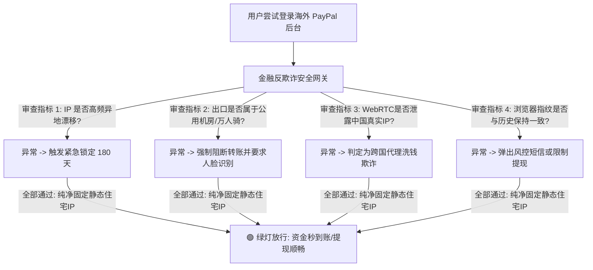

# 4-14. PayPal 跨区收款风控严重？如何使用干净节点安全登录海外 PayPal

在跨境电商、外贸 B2B 小额样品单收款、海外自由职业者接单（Upwork / Fiverr）以及独立站建站中，**PayPal（贝宝）** 始终是全球普及率最高、欧美买家信任度最强的收单结算工具。无论是开通美区 PayPal、港区 PayPal 还是新加坡 PayPal，其支持全球多币种无缝提现的便利性，使其成为了出海人资金链上的核心命脉。

然而，对于国内跨境从业者而言，海外 PayPal 几乎是一座伴随着巨大风险的“达摩克利斯之剑”：**刚刚收到客户一笔几百美元的付款，账户突然弹窗提示限制访问（Your account access has been limited）**、**要求上传极其苛刻的海外本地水电账单、护照与社保税号（SSN/ITIN）**、最致命的是直接被判定为 **“违反可接受使用政策（Acceptable Use Policy）”，账户被永久注销，且卡内数万美元资金被强制冻结长达 180 天之久**！

“我的交易完全合规真实、产品也有真实的国际物流发货单号，为什么 PayPal 动不动就下死手风控我？” 绝大多数外贸卖家不知道的是，**PayPal 拥有全华尔街最敏锐、最严苛的“反洗钱与异地欺诈风控引擎”。而在所有的诱发诱因中，你所使用的“翻墙网络节点”是否纯净稳定，直接占据了风控打分权重的 70% 以上！**

想要让你的海外 PayPal 账户长期稳如磐石、杜绝资金被冻结清零的惨剧，选对合规免检的底层固定网络出口是第一生命线，建议系统研读我们的年度出海防封全景横评报告：《[TikTok 与跨境电商防关联独享原生 IP 方案推荐](/pillar-4)》。本文将为你深入剖析 PayPal 底层的金融风控模型，并手把手教你如何用真正干净的节点安全维护海外 PayPal。

---

## 一、幕后解密：PayPal 的风控黑匣子到底在盯什么？

PayPal 作为受多国中央银行与金融监管局严格监管的第三方持牌支付机构，其安全审查逻辑与普通互联网网站有着本质区别。当你尝试登录海外 PayPal 时，后台的风控引擎（包含基于神经网络构建的 Fraud Detection System）会在毫秒级时间内对你执行多维度环境画像：

### 1. 致命的“跨大洲异地瞬移（Geo-Anomaly）”
*   许多人使用普通机场节点登录 PayPal，每次连接的出口都不一样：昨天在香港、今天在达拉斯、明天在西雅图；
*   在金融风控系统看来，**一个在物理世界上不可能在数小时内横跨大洋的账户登录轨迹，100% 对应着“账户遭受黑客跨国撞库窃取”**！为了防范资金损失，系统会在第一时间启动“保护性限制”，直接锁死资金转出权限。

### 2. 属于“数据中心机房（Hosting）”的欺诈原罪
普通翻墙节点使用的是 AWS、阿里云国际等云服务器的公网 IP。正常海外居民绝对不会坐在数据中心机房的服务器机架上去刷 PayPal 账单！挂着机房 IP 登录，在反洗钱系统眼里等同于“故意使用匿名代理隐藏行踪的黑产团伙”。

### 3. 多人混用引发的“高危污点连坐”
如果你使用的梯子 IP 上，曾有其他陌生黑产用户从事过信用卡盗刷（Carding）、洗钱或欺诈拒付，该 IP 会被 Visa/Mastercard 和 PayPal 列入最高级别的黑名单。你使用该节点登录，当场被系统认定为违规同伙并就地正法！

---

## 二、海外 PayPal 长期安全存活的“黄金网络四铁律”

想要让你的美区、港区或欧区 PayPal 活得比谁都长久，必须在日常操作中严格贯彻执行以下四条刚性纪律：

### 铁律一：必须配备“纯正独享的静态住宅双 ISP 节点”
*   **绝对固定（Static）：** 保证在 1 个月、半年乃至 1 年内，登录 PayPal 的 IP 地址**绝对恒定不变，永远固定在那一个唯一的地址上**；
*   **绝对独享（Dedicated）：** 确保该 IP 资源 100% 由你一个人独占独享，没有任何陌生邻居的任何污染；
*   **真实民用宽带（ISP）：** 在 [ipinfo.io](https://ipinfo.io) 查询，ASN Type 必须为 `isp`（如美国电信运营商 AT&T, Verizon），在银行系统看来，你就是一个正规的海外本地居民。

### 铁律二：软硬件环境的“绝对物理隔离”（指纹浏览器配合）
*   切勿在平时登录百度、淘宝的普通主力浏览器中直接打开 PayPal；
*   使用专业防关联工具（如 **AdsPower**），专门开辟一个独立的纯净浏览器环境，命名为 `美区PayPal专属提现环境`；
*   将该环境的时区、语言、WebRTC 设置为**基于绑定的静态住宅 IP 自动对齐**，彻底封死 WebRTC 真实中国 IP 泄漏通道。

### 铁律三：新账户初期的“温和养号周期（Warm-up Period）”
海外 PayPal 刚注册后的前 21 天被称为“婴儿期”：
1. **前两周：** 不要一上来就收取数千美元的大额商业货款！
2. **前几次收款：** 先进行 2 到 3 笔 10–20 美元的小额真实样品费转账，让资金在账户内停留沉淀至少 3 到 5 天再申请提现；
3. **建立行为基线：** 每次登录都在固定的静态住宅 IP 下进行，让风控系统彻底习惯并信任你的网络指纹。

### 铁律四：移动端与电脑端的网络出口必须 100% 保持一致
如果需要在手机上的 PayPal App 查看账单：
*   必须在手机小火箭或代理客户端中，**手动指定该相同的静态住宅专线**；
*   **坚决杜绝：** 电脑端挂在美国加州静态 IP，手机端却在未开代理（中国电信直连）的状态下误点打开 PayPal App！这种跨网穿帮会导致账户瞬间遭遇不可逆的永久封禁！

---

## 三、结语
金融资产安全，是出海业务最经不起折腾的核心命脉。不要为了省下每个月几十元的基础网络投入，而让几万甚至几十万美元的货款面临被冻结 180 天的绝境。为你的海外 PayPal 搭建一套纯净独享的静态住宅网络专线，把风险挡在门外，你的跨境财富之路才能真正走得长久而踏实！
