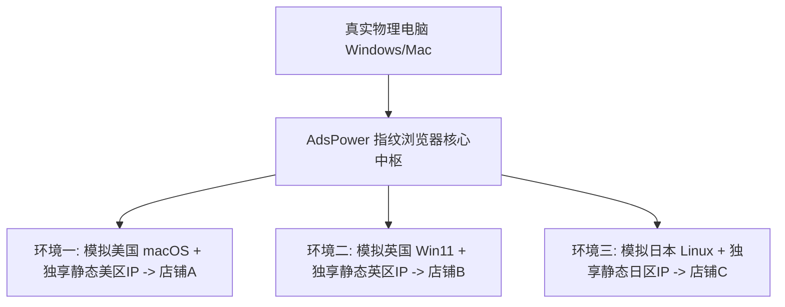

# 4-3. AdsPower 指纹浏览器怎么配置代理节点防关联？保姆级教程

在跨境电商多店铺矩阵运营（如亚马逊多账号、eBay、Shopee、TikTok Shop、Etsy 以及 Facebook 批量广告投放）的领域中，**“防关联（Anti-Detection）”** 是每一位操盘手必须刻在骨子里的生存法则。各大电商平台与社交媒体巨头拥有极其灵敏的风控算法，只要检测到多个账号来自同一台物理电脑、同一个浏览器内核、或者同一个公网 IP，就会立刻实施“一窝端”式的无差别封杀。

为了实现多账号的绝对安全隔离，**防关联指纹浏览器（以业内老牌标杆 AdsPower 为代表）配合独立高纯净代理 IP**，成为了整个出海行业最成熟、最标准的工业级基础设施方案。

然而很多刚刚接触指纹浏览器的新手，在配置代理时却频繁踩坑：不知道什么是 HTTP/SOCKS5 代理协议、代理测试连接总是超时报错、环境伪装度只有 60%、或者配置完依然发生了店铺关联惨案。要确保多账号环境万无一失，配置前深刻理解底层网络选型与防封逻辑至关重要，推荐深入阅读我们的年度选型横评专栏：《[TikTok 与跨境电商防关联独享原生 IP 方案推荐](/pillar-4)》。本文将为你提供一份零基础、手把手、图文级的 **AdsPower 代理节点配置保姆级全流程指南**。

---

## 一、硬核底层：AdsPower 到底是如何实现“防关联”的？

在动手配置之前，先理清防关联的两个核心支撑点：**“指纹伪装”** 与 **“网络隔离”**。

1. **软件层（浏览器环境指纹）：**  
   AdsPower 会深度修改 Chromium 底层内核，为每一个新建的浏览器窗口生成一套**独一无二的硬件指纹特征**（包含 Canvas 画布哈希、Audio 声卡指纹、WebGL 显卡渲染器、系统字体库、屏幕分辨率、User-Agent 等）。在亚马逊或 TikTok 眼里，每一个窗口就是一台完全独立的全新物理电脑。
2. **网络层（独立专属代理 IP）：**  
   单有硬件伪装还不够！如果 10 个不同的独立窗口共用同一个宽带 IP 出境，平台依然能通过 IP 关联封号。因此，**必须为每一个指纹环境，配置一个绝对独立的“独享静态住宅 IP”**，实现软硬件与网络链路的双重 100% 隔离。

---

## 二、准备工作：提前备齐两项核心物料

1. **安装 AdsPower 客户端：** 在官网下载并安装最新版的 AdsPower 指纹浏览器，注册并登录账号；
2. **一套合规的静态独享代理节点：** 从正规商业代理服务商处获取你的专属代理参数。通常格式如下：
   *   **代理类型：** `Socks5` 或 `HTTP`
   *   **IP 地址（或主机域名）：** 例如 `104.28.188.66`
   *   **端口（Port）：** 例如 `10800`
   *   **账号（Username）：** 例如 `user_adspower_01`
   *   **密码（Password）：** 例如 `pass_secret99`

---

## 三、实操演示：在 AdsPower 中配置代理节点的 5 步 SOP

### 第一步：打开 AdsPower 并点击“新建浏览器”
1. 登录 AdsPower 客户端主界面；
2. 点击左侧导航栏的 **“账号管理”**；
3. 点击顶部的蓝色按钮 **“+ 新建浏览器”**，进入全新独立环境配置面板。

### 第二步：填写基础信息与分组
*   **浏览器名称：** 为该环境起一个清晰好记的别名（例如 `Shopify-美区旗舰店-01` 或 `TikTok-美区矩阵-03`）；
*   **分组管理：** 选择所属的业务业务分组，方便日后团队协作权限划分。

### 第三步：配置代理网络信息（核心关键点）
在“网络配置”区域，找到 **“代理配置 (Proxy configuration)”**：
1. **代理类型 (Proxy Type)：** 根据你购买的节点协议，在下拉框中选择 **`Socks5`**（推荐，传输效率高）或 **`HTTP/HTTPS`**；
2. **选择“自定义代理”；**
3. **依次填入代理四要素：**
   *   **代理主机 (Proxy Host)：** 粘贴你的节点 IP 地址；
   *   **代理端口 (Proxy Port)：** 填入对应数字端口；
   *   **代理账号 (Proxy Username)：** 填入认证用户名；
   *   **代理密码 (Proxy Password)：** 填入对应密码。
4. **点击“测试代理 (Check Proxy)”按钮：**
   *   **成功标志：** 按钮后方瞬间显示绿色的 **“连接测试成功”**，并自动读取出该 IP 的地理位置（如 `United States - Los Angeles`）以及本地出口公网 IP；
   *   **如果报错“连接超时”：** 检查账号密码是否有多余空格，或者确认本地网络是否被防火墙拦截。

### 第四步：高级指纹参数与地理位置自动匹配（自动化核武器）
在代理配置下方，展开 **“高级指纹设置 (Advanced Settings)”**：
1. **时区 (Timezone)：** 务必勾选 **“基于 IP 自动匹配”**！AdsPower 会根据你刚刚绑定的代理节点物理经纬度，自动将该环境的时区调整为当地时区（彻底消灭时区穿帮风险）；
2. **WebRTC：** 务必设置为 **“替换 (Replace)”** 或 **“禁用 (Disable)”**，杜绝 WebRTC 穿透代理泄露你本机的中国真实局域网 IP；
3. **地理位置 (Geolocation)：** 勾选“根据 IP 自动匹配”并开启“询问或允许”；
4. **语言 (Language)：** 勾选“基于 IP 自动匹配”，确保访问海外网站时首选语言自动呈现纯正的本地英语。

### 第五步：保存并打开环境进行终极验收
1. 点击面板右下角的 **“确定”**，完成环境创建；
2. 在账号列表中，找到刚刚新建的环境，点击绿色的 **“打开 (Open)”** 按钮；
3. 此时系统会自动弹出一个全新的独立浏览器窗口；
4. 在该窗口中打开检测站：[whoer.net](https://whoer.net) 或 [browserleaks.com](https://browserleaks.com)：
   *   核对 IP、国家、时区、DNS 是否全部一致；
   *   **综合伪装度得分必须呈现满分 100%（绿标）！**

---

## 四、矩阵多账号运营的 3 条高压红线

为了保证多店铺永世不被关联封禁，请严格遵守以下操作纪律：
1. **一号一 IP 一环境，绝对不交叉混用：**  
   A 店铺的环境绝对不要在某些天临时切换去登录 B 店铺；哪怕同一天不同时间段也不行，平台的永久 Cookie 追踪会在后台记录所有的访问关联。
2. **严禁在指纹环境中安装任何国内浏览器插件：**  
   不要在 AdsPower 的独立环境中安装任何诸如“有道词典”、“微信网页助手”等国内扩展，这些插件会将国内特征指纹注入到请求头中。
3. **定期检查代理节点的有效期：**  
   静态住宅代理通常是按月续费，提前设置好自动续费提醒，避免因欠费断连导致 IP 被释放被他人租用。

---

## 五、结语
防关联是一场精细化的工程体系。学会利用 AdsPower 的强大指纹内核，搭配纯净独享的静态住宅专线节点，你的跨境多店铺矩阵就像拥有了一支互不相通、高度隐匿的特战舰队，在激烈的海外商业竞争中乘风破浪、安如磐石！
